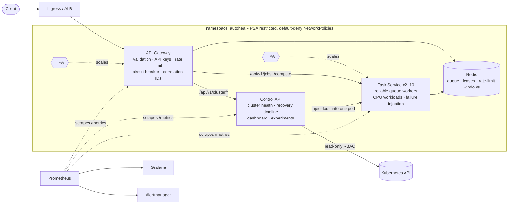

# AutoHeal — Self-Healing Microservices on Kubernetes

[](https://github.com/sahasra24/autoheal/actions/workflows/ci.yml)


AutoHeal is a cloud-native platform of three FastAPI microservices that **detects failures, recovers from them automatically, and scales with load**. You can break it on purpose: a guarded failure-injection API crashes processes, wedges health checks, leaks memory, deletes pods and saturates CPU. You then watch Kubernetes heal it, on a live dashboard and in Grafana, with measured recovery times.

Recovery and scaling use Kubernetes' own machinery: probes, ReplicaSets, the kubelet and the HPA. Custom code is added only where it adds something real: a reliable job queue that survives pod death, a circuit breaker, a distributed rate limiter, and an API that explains what the cluster is doing.



## What it demonstrates

| Area | Implementation |
|---|---|
| **Microservices** | Gateway, task processor and control API. Each has its own image, scaling, service account and network policy. A shared library supplies one observability contract. |
| **Self-healing** | Startup, liveness and readiness probes with distinct semantics. Restarts via `restartPolicy`, pod replacement via ReplicaSets, PDBs, topology spread, graceful drain (`preStop` + SIGTERM handling), `helm --atomic` rollback on bad deploys. |
| **Job durability** | Redis reliable queue (`BLMOVE` + leases + reaper). Jobs on a pod that dies are re-queued exactly once and finished by a survivor, with at-least-once delivery and fencing so stale workers can't overwrite results. |
| **Resilience at the edge** | Sliding-window rate limit shared by all gateway replicas, which keeps serving if Redis is down. Per-upstream circuit breaker, retry of idempotent reads, timeouts, body-size limit, optional API keys. |
| **Autoscaling** | `autoscaling/v2` HPAs with tuned scale-up/scale-down behaviour. CPU work runs in a process pool, so health probes stay responsive under saturation. |
| **Observability** | JSON logs with correlation IDs propagated across services and onto jobs. RED metrics by route template. Job, queue, breaker and rate-limit metrics. 13 alert rules. A Grafana dashboard generated from code. |
| **Security** | Non-root, read-only root filesystem, all capabilities dropped, seccomp. Restricted Pod Security Admission. Least-privilege RBAC (only the control API can call the K8s API). Default-deny NetworkPolicies. Secrets generated on install. Chaos endpoints token-gated and impossible to enable in `production`. |
| **CI/CD** | GitHub Actions runs lint, 88 tests (92% coverage), chart lint plus kubeconform, and image builds. **An end-to-end job boots a kind cluster, crashes pods and asserts they recover.** CD pushes to ECR and deploys to EKS through OIDC (no stored AWS keys). |

## Quick start

### Option A: Docker Compose (no Kubernetes needed)

```bash
docker compose up --build -d
```

| URL | What |
|---|---|
| http://localhost:8080/docs | Gateway Swagger UI |
| http://localhost:8090 | Control dashboard (cluster views need Kubernetes) |
| http://localhost:3000 | Grafana (admin/admin) → *AutoHeal / Platform Overview* |
| http://localhost:9090 | Prometheus (alerts tab) |

```bash
# submit a job and read it back
curl -s -X POST localhost:8080/api/v1/jobs -H 'Content-Type: application/json' \
  -d '{"type":"prime_count","params":{"limit":500000}}'
curl -s localhost:8080/api/v1/jobs?limit=5
```

Compose restarts crashed containers but **not** unhealthy ones, and it cannot route around unready replicas or autoscale. That gap is the point of option B.

### Option B: Local Kubernetes (minikube or kind)

Prerequisites: Docker, kubectl, Helm 3, minikube **or** kind, and GNU make (Git Bash or WSL on Windows).

```bash
make cluster-up                  # minikube with Calico CNI + metrics-server   (CLUSTER=kind for kind)
make images-load                 # build the 3 images and load them into the cluster
make monitoring-up               # optional: kube-prometheus-stack (Prometheus, Grafana, Alertmanager)
make deploy VALUES=helm/autoheal/values-local.yaml   # omit VALUES if you skipped monitoring
make port-forward                # gateway :8080, control dashboard :8090, Grafana :3000
```

Open http://localhost:8090, paste the chaos token printed by `make port-forward`, and press **Crash**.

### Run the self-healing scenarios

```bash
make demo        # runs every scenario and prints detection / recovery times
```

```text
=== crash -> tasks ===
  injected into autoheal-tasks-7d9c...: target answered 202
  expected: Process exits -> kubelet restarts the container (restartPolicy: Always); restart count +1.
  [   1.0s] failure detected on autoheal-tasks-7d9c... (not ready or already restarted)
  [   9.6s] container restarted by kubelet (restarts 0 -> 1, last exit: Error)
  => recovered in 9.6s
```

*(Illustrative output. Run it yourself and record your own numbers in [docs/self-healing-scenarios.md](docs/self-healing-scenarios.md).)*

| # | Scenario | Injected fault | Kubernetes mechanism | Command |
|---|---|---|---|---|
| 1 | Container crash | `os._exit(1)` | kubelet restart (`restartPolicy: Always`) | `chaos_demo.py crash` |
| 2 | Unhealthy app | `/health/live` → 503 | liveness probe → restart | `chaos_demo.py unhealthy` |
| 3 | Not ready | `/health/ready` → 503 | readiness probe → removed from Service endpoints, no restart | `chaos_demo.py unready` |
| 4 | Pod deleted | pod deleted via API | ReplicaSet creates a replacement | `chaos_demo.py pod_delete` |
| 5 | Memory leak | allocate past the limit | kernel OOM kill → `OOMKilled` → restart | `chaos_demo.py memory_leak` |
| 6 | Traffic spike | CPU burn / Locust | HPA scales 2 → N, then back | `chaos_demo.py cpu_stress`, `make loadtest` |
| 7 | Dependency outage | Redis pod deleted | tasks go unready (no restart storm); gateway rate limiter fails open; Redis replaced; everything rejoins | `chaos_demo.py pod_delete --target redis` |
| 8 | Worker dies mid-job | crash during a long job | lease expires → another pod's reaper re-queues → job completes | see scenarios doc |
| 9 | Bad deployment | image whose probes never pass | `maxUnavailable: 0` keeps old pods serving; `helm --atomic` rolls back | see scenarios doc |

Details, expected timings and what to watch for each one: **[docs/self-healing-scenarios.md](docs/self-healing-scenarios.md)**.

## API

Through the gateway (`:8080`, OpenAPI at `/docs`):

| Method | Path | Notes |
|---|---|---|
| `POST` | `/api/v1/jobs` | `{"type": "prime_count"\|"hash_chain"\|"sleep"\|"flaky", "params": {...}, "max_attempts": 1-5}` → `202` + `Location` |
| `GET` | `/api/v1/jobs?limit=&status=` | recent jobs |
| `GET` | `/api/v1/jobs/{id}` | status, attempts, worker pod, result, correlation ID |
| `POST` | `/api/v1/compute` | synchronous CPU work (load-test lever) |
| `GET` | `/api/v1/queue` | queued / processing depth |
| `GET` | `/api/v1/cluster/{overview\|deployments\|pods\|autoscalers\|events\|recovery}` | read-only cluster views |

Every response carries `X-Correlation-ID` and `X-RateLimit-*` headers. Failure injection is **not** reachable through the gateway, only on the control service's internal port.

Control service (`:8090`): the same cluster views plus `GET /api/v1/chaos/scenarios`, and `POST|GET /api/v1/chaos/experiments` (requires `X-Chaos-Token`).

## Repository layout

```
libs/common/            shared library: logging, correlation IDs, metrics, health model, failure injection, schemas
services/gateway/       API gateway (rate limiter, circuit breaker, access control, proxy routes)
services/tasks/         task service (reliable Redis queue, worker pool, workloads)
services/control/       control API (Kubernetes adapter, recovery timeline, experiments, dashboard)
helm/autoheal/          Helm chart: deployments, services, HPA, PDB, RBAC, NetworkPolicy, ServiceMonitor,
                        PrometheusRule, Grafana dashboard. files/ holds alert rules + dashboard JSON
deploy/compose/         Prometheus/Grafana config for docker compose
deploy/k8s/             namespace (PSA), kind config, kube-prometheus-stack values
deploy/eks/             eksctl cluster, gp3 StorageClass, GitHub OIDC trust policy
scripts/                chaos_demo.py (scenario runner), e2e.sh, build_dashboard.py
loadtest/               Locust scenarios with a stepped load shape
docs/                   architecture, scenarios, AWS deployment
```

## Development

```bash
python -m venv .venv && source .venv/bin/activate     # Windows: .venv\Scripts\activate
make install
make test        # 88 tests, ~20s, no Docker or Redis needed (fakeredis + mock transports)
make lint        # ruff + helm lint + kubeconform
```

## Deploying to AWS

AWS is optional. EKS and its load balancer cost money, so tear them down when you're finished. **[docs/aws-deployment.md](docs/aws-deployment.md)** covers `eksctl` cluster creation, ECR, the AWS Load Balancer Controller, GitHub OIDC for keyless CD, and cleanup.

## Design notes

See **[docs/architecture.md](docs/architecture.md)** for the reasoning behind the main decisions. For example, why liveness never checks dependencies, why the rate limiter fails open, why CPU work runs in a process pool, and how the job queue survives a pod being killed mid-job.
